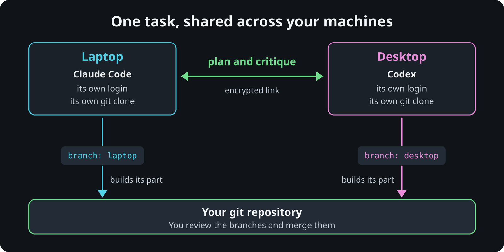
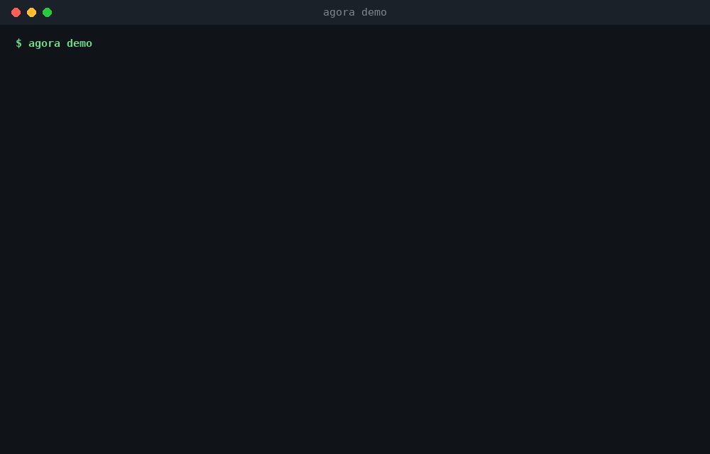
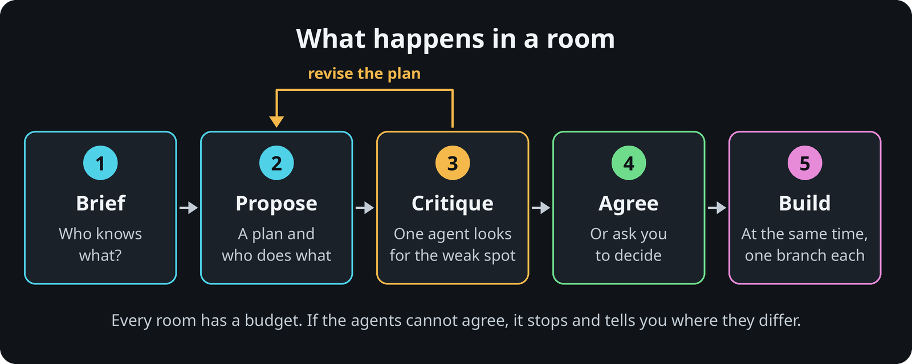

# agora-mesh

**Connect coding agents across your machines so they plan together, split the work, and push to separate git branches.**

You have a laptop and a desktop, each with a coding agent. Today you copy context between them and decide who does what. With agora-mesh you give one task to one of them. The agents brief each other, challenge the plan, divide the work, and each pushes its part to its own branch. You review and merge.



- **Works with the agents you already use.** Built for Claude Code. Codex and OpenCode have worked in real rooms too.
- **Every machine keeps its own login and files.** agora-mesh never sees a login or a key.
- **Nothing to host.** No VPN, no server of your own, no MCP. Machines connect directly and encrypted. Public [iroh](https://www.iroh.computer) relays help them find each other, and carry the traffic if no direct path exists.

> **Early development, version 0.6.0.** An independent community project, not affiliated with Anthropic. [What has and has not been tested](#what-has-been-tested).

## Try it in one minute

You need one machine, git and an internet connection. No account, no API key, no Claude Code.

```
# macOS on Apple Silicon
curl -fLo agora https://github.com/kn0sti/agora-mesh/releases/latest/download/agora-aarch64-apple-darwin

# Linux on x64
curl -fLo agora https://github.com/kn0sti/agora-mesh/releases/latest/download/agora-x86_64-unknown-linux-musl

chmod +x agora
./agora demo
```

Other platforms are on the [releases page](https://github.com/kn0sti/agora-mesh/releases/latest).



The connection, the room and the git branches are real, **but the agents are scripted**, so it shows the process and not the quality of a model. It uses no tokens and cleans up after itself.

## Use it on your own project

```
claude plugin install agora-mesh --marketplace kn0sti/agora-mesh
```

The plugin adds the `agora` command inside Claude Code, so run the next steps there or ask your agent to. In a plain terminal, use the binary from above. [INSTALL.md](INSTALL.md) has the full steps, and `cargo build --release` builds it from source.

**Connect two machines.** Only connect machines you trust: a connected machine [can run commands on yours](#security).

```
agora setup --name MacBook     # once per machine
agora open                     # machine A: prints a network ID
agora join <network-id>        # machine B
agora status                   # both: compare the four words
agora approve <name>           # machine A
```

**Start your first room.** Each machine needs a clone of the same repository.

```
# machine B, once: register its clone
agora project add ~/code/my-app

# machine A: open the room
cd ~/code/my-app
agora discuss "Add rate limiting to the API" --approve

# machine B: accept the invitation
agora rooms
agora accept <room>
```

With `--approve` the room shows you the agreed split and waits. `agora go <room>` starts the work.

**Use a clean clone.** The agents work directly in it and switch its branch, so do not point them at the folder you are editing in.

## When it helps

- **The task is too big for one session.** Each agent has its own context and works on its own part at the same time.
- **The knowledge is on different machines.** Each agent can use the files, tools and access of its own machine.
- **You want a second opinion.** Put two strong models on one plan, or a different agent next to yours, and let them argue before anything is built.
- **You want one memory everywhere.** Notes an agent saves appear on all your machines as Markdown, and [can sync with Obsidian](docs/shared-memory.md).

**When it does not help:** small tasks. A room costs more tokens and time than one agent. In one measured design question, a room of three used 712k tokens in 104 s, one agent alone 179k tokens in 34 s.

## What happens in a room



In a real test run (three daemons on one Mac), three different agents exchanged 13 messages in 325 s and pushed one branch each, leaving `main` untouched ([full log](docs/measurements/2026-11-real-agents.md)).


## agora-mesh or Hermes Agent?

They do different jobs.

[Hermes Agent](https://github.com/NousResearch/hermes-agent) by Nous Research is a personal agent that grows with you: it builds memory and skills, runs scheduled jobs, and talks to you in Telegram, Discord or Slack. If you want one assistant that knows you, use Hermes.

agora-mesh does not replace that. It connects existing agents across machines so they can work on one task as equals.

| | agora-mesh | Hermes Agent |
|---|---|---|
| **What it is** | a link between separate agents | one persistent personal and coding agent |
| **Parallel work** | agents on different machines, one branch each | helper agents under one parent, or a task board across profiles |
| **Several machines** | each runs its own agent, login and clone | one agent can run commands remotely over SSH or in sandboxes; its task board is [single-host by design](https://hermes-agent.nousresearch.com/docs/user-guide/features/kanban) |
| **Memory and skills that grow** | a shared notebook, no learning | its main strength |
| **Chat apps, scheduled jobs** | no | yes |

Hermes can speak the [Agent Client Protocol](https://agentclientprotocol.com), which agora-mesh uses for other agents, so it may work as a peer. **We have not tested that yet.** Facts about Hermes are from its documentation on 2026-11-21.

## Security

**A connected machine can make yours run commands.** Agents need that to work together. This applies to whoever controls the other machine and to anything their agent reads, including web pages or files with a prompt injection. **Connect only machines and people you would trust with a shell on your computer.**


| Command | What it does |
|---|---|
| `agora discuss … --approve` | wait for your go before any work starts |
| `agora trust <name> --work ask` | work from this peer waits for your go on this machine |
| `agora trust <name> --rights read` | this peer's sessions here may only read (`talk`: no tools at all) |
| `agora revoke <name>` | remove a peer |
| `agora panic` | stop every room and session on this machine |

By default a room that agrees starts working at once, with full rights. [The details](docs/security.md).

## What has been tested

**Ran for real:** rooms and work phases between a Mac and a Linux machine with Claude Code, and rooms with Codex, OpenCode and Claude Code on DeepSeek and GLM.

**Never run so far:**

- two different accounts in one room
- a real NAT between two networks
- Windows, apart from an automated demo run
- a real usage limit (the handover was simulated)
- agents other than OpenCode, Qwen Code and Codex, including Hermes
- larger tasks on models other than Claude

If you try one of these, [report how it went](https://github.com/kn0sti/agora-mesh/issues/new?template=worked_for_me.yml).

## Everyday commands

| Command | What it does |
|---|---|
| `agora peers` | who is online and what they are doing |
| `agora ask "<question>"` | ask another machine's agent one question |
| `agora delegate "<task>"` | hand a task to another machine |
| `agora review` | have another agent review your changes |
| `agora discuss "<topic>"` | open a room: plan, split and build together |
| `agora watch <room>` | follow a room live |

[All commands](docs/commands.md).

## Learn more

- [How it works](docs/how-it-works.md) and the full [architecture](ARCHITECTURE.md)
- [Other agents and models](docs/other-agents.md), including what has actually run
- [What was measured](docs/measurements/README.md), with the honest comparisons
- [Accounts, plans and terms](docs/accounts-and-terms.md): read this before you share a room with someone else
- [Compared with other ways to connect sessions](docs/compared.md)
- [Contributing](CONTRIBUTING.md) and [discussions](https://github.com/kn0sti/agora-mesh/discussions)

## License

[MIT](LICENSE)
