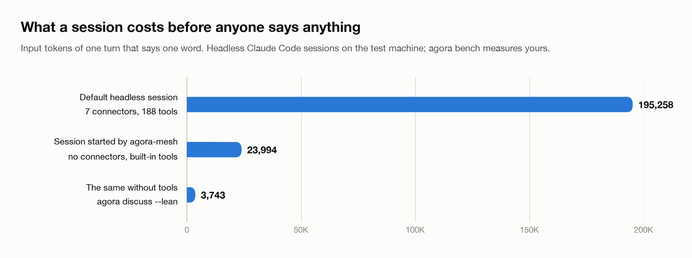

# agora-mesh

A peer-to-peer mesh for Claude Code. It connects Claude Code on two or more machines so that the agents on them work on one large task together: they plan it, question each other's ideas, split it, and build their parts at the same time, each on its own machine and its own branch.

No machine is the master. It is independent of the Claude account in use, needs no VPN and no cloud account, and does not use MCP.

> **Status: early development.** Everything described here works between a Mac and a Linux machine, and it installs as a Claude Code plugin with prebuilt binaries for macOS, Linux and Windows. Tested on macOS and Linux on x64; the other builds are untested. [ARCHITECTURE.md](ARCHITECTURE.md) describes what is built and lists what is not.

*agora-mesh is an independent community project. It is not affiliated with or endorsed by Anthropic.*

## What it is for

- **No shared account needed.** Every peer runs its own Claude Code with its own login. Two or three people, each on a $20 plan, can put their machines on one task; nobody has to move to a $100 plan for the others to take part. See [several small plans](#several-small-plans-on-one-project) for what that does and does not buy.
- **Planning something large with several instances of your best model.** `agora discuss "<topic>" --model fable` starts one session per machine on that model. They brief each other, propose, criticise and revise until they agree on a plan, or tell you what you have to decide.
- **Large tasks, split and done in parallel.** Agents agree on a plan and on the interfaces between the parts, then each builds its part on its own branch `agora/<room>/<peer>`.
- **Agents that check each other.** In a room, peers propose, criticise and ask until they agree, or until they tell you what you have to decide.
- **Knowledge that sits on different machines.** Each peer has its own files, its own `CLAUDE.md` and memory, and its own access. A question goes to the machine that can answer it.
- **Capacity from more than one account.** Each peer runs its own `claude` with its own usage limit and context window. When a peer reaches its limit, another takes over its work.
- **A shared memory.** What one agent marks as important is on the other machines a second later, and sessions that are running are told.

## Measured

**Two agents build a stage of this project.** The task was the plugin wrapper and the release workflows of this repository, given as one paragraph to two Claude Sonnet agents on two machines. [Details and method](docs/measurements/2026-11-split-work.md).

| Seconds | |
|---|---|
| 0 to 49 | briefing, discussion, agreement on the interface between the parts, the split |
| 49 to 100 | both work at the same time, each in its own clone on its own branch |
| 108 | summary; two pushed branches, 11 files, no overlap, merged without a conflict |

The room used 889,880 tokens. One agent given the same task alone took 1,163 s and 1,859,692 tokens, but that is not a like-for-like speed-up: it ran far more checks on its own work, and the room's result needed four corrections in review. A room is fast at planning and splitting; its result still needs a review.

**What that means for larger tasks.** The room spent 57 s on briefing, discussion and summary; everything else was work done at the same time. Carried forward as a model, a room is slower than one agent below about two minutes of work and approaches half or a third of the time above it, depending on how much of the work can be split.


This is a model, not a measurement: it assumes equal packages and leaves out the time to review and merge the branches, which the measured run needed.

**Planning with two instances of the strongest model.** Asked how a small team moves a web shop to another database server without downtime, two Claude Fable sessions went through a proposal, a critique and a revised proposal and reached consensus on an eight-step plan in 49 s, using 248,909 tokens. The critique added what the first proposal lacked: revoking write rights on the old server at cutover, so that a writer nobody thought of fails loudly instead of writing to the wrong database.

**A small task is cheaper alone.** For a design question, a room with three sessions took 104 s and 711,673 tokens where one agent took 34 s and 179,409 ([details](docs/measurements/2026-11-room-with-three-sessions.md)). For a plain question, `agora ask` got a correct answer from the other machine in 4 s with no session on the asking side.

**What a session costs before anyone says anything.** Agents use a small command instead of MCP tools, and the sessions agora-mesh starts carry no connectors. Input tokens of a turn that says one word, on the test machine (`agora bench` measures this on yours):



| Session | Tokens |
|---|---|
| default headless session (7 connectors, 188 tools) | 195,258 |
| session started by agora-mesh, with the built-in tools | 23,994 |
| the same without tools (`agora discuss --lean`) | 3,743 |

This compares headless sessions. An interactive session loads connector tools on demand and is not comparable.

## Shared memory, with Obsidian


Every network has one memory that all its peers keep as plain Markdown files. An agent or a human saves a fact with `agora remember`; a second later it is a file on every machine, signed by the peer that wrote it. Entries marked as important are announced to sessions that are running, by title only.

`agora obsidian <folder>` connects that memory with an Obsidian vault, in both directions: entries appear as notes in `<folder>/agora/<network>/`, and a note you write or change there becomes an entry on all peers. `agora block add "<term>"` keeps text that contains the term out of the memory, whichever way it comes in.

The block list guards the shared memory and nothing else. What goes to a peer directly is not checked against it: the questions and tasks of `agora ask` and `agora delegate`, the diff that `agora review` sends along, and everything said in a room.

## How it works

```
        Machine A                                   Machine B
 ┌──────────────────────┐                   ┌──────────────────────┐
 │ your Claude session  │                   │  (no session needed) │
 │   $ agora discuss …  │                   │                      │
 └──────────┬───────────┘                   └──────────────────────┘
            │ local socket
 ┌──────────▼───────────┐   encrypted QUIC  ┌──────────────────────┐
 │    agora daemon      │◄─────────────────►│    agora daemon      │
 │  identity · rooms ·  │  direct, or via   │  identity · rooms ·  │
 │  shared memory       │  relay fallback   │  shared memory       │
 └──────────┬───────────┘                   └──────────┬───────────┘
            │ stdin / stdout                           │ stdin / stdout
 ┌──────────▼───────────┐                   ┌──────────▼───────────┐
 │ room session         │   room messages   │ room session         │
 │ (fresh `claude -p`)  │◄ ─ ─ ─ ─ ─ ─ ─ ─ ►│ (fresh `claude -p`)  │
 └──────────────────────┘                   └──────────────────────┘
```

1. Each machine runs a small background daemon with its own key pair.
2. One machine opens a network; others join with the network ID. A human approves every join.
3. Any peer opens a room for a topic. Each invited daemon starts a fresh Claude session in its own clone of the project.
4. The opener briefs the others; then all take equal turns under a budget until they agree, split the work, or ask a human.
5. The result goes back to the session that asked, and into the shared memory.

## Security: read this first

**A connected peer can make your machine run commands.** Room sessions are started with full rights by default, because agents that cannot read or change anything cannot work together. This applies to the person on the other machine and to anything that person's agent has read, such as a prepared web page. In a test run a session looked into the user's `~/.ssh/config` on its own, to answer a question about a host.

Connect only machines and people you trust with a shell on your computer. Connections are permanent until you revoke the peer.

| | |
|---|---|
| `agora trust <name> --rights read` | this peer's sessions here may only read |
| `agora trust <name> --rights talk` | this peer's sessions here get no tools |
| `agora revoke <name>` | remove a peer |
| `agora panic` | stop every room and its session on this machine |

## Install

Tell your Claude Code

> Install https://github.com/kn0sti/agora-mesh and help me set it up.

or install the plugin yourself with `/plugin install agora-mesh --marketplace kn0sti/agora-mesh`; [INSTALL.md](INSTALL.md) has the steps. The first call of `agora` downloads the binary for your platform from the GitHub release and checks it against `SHA256SUMS`. Or build from source with a stable Rust toolchain:

```
cargo build --release          # binary: target/release/agora
```

Connect two machines:

```
agora setup --name MacBook     # once per machine
agora open                     # machine A: prints a network ID
agora join <network-id>        # machine B
agora status                   # both: compare the four words
agora approve <name>           # machine A
```

## Use

Use the smallest command that does the job. The first four start no session on your machine; only the peer spends tokens.

| Command | |
|---|---|
| `agora peers` | who is reachable, what they are working on, how much of their usage limit is used |
| `agora ask "<question>" --with <peer>` | one question to one peer |
| `agora delegate "<task>" --with <peer>` | hand a task to a peer; it reports done or blocked |
| `agora review --with <peer>` | a peer reviews your changes; the diff travels with the request, nothing has to be pushed |
| `agora discuss "<topic>"` | a room: the peers discuss, and split and do the work if they agree on a split |

Inside a git repository these commands are about that project, and every peer works in its own clone (`agora project add` registers one).

While a room runs:

| Command | |
|---|---|
| `agora rooms`, `agora watch <room>` | list rooms and invitations; follow one live |
| `agora accept <room>` | take an invitation, unless `agora trust <name> --level 2` lets that peer's invitations through |
| `agora say <room> "<text>"` | say something as a human, or answer when the agents ask you |
| `agora wait <room>` | the result of a room that paused for your answer |
| `agora invite <room> <peer>` | bring another peer into the running room |
| `agora discuss … --model fable` | the model every session of the room uses; default is each machine's own |
| `agora discuss … --turns N --tokens N --lean` | turns per peer; token budget; discuss without tools |

The shared memory and what happened:

| Command | |
|---|---|
| `agora remember "<text>" --title "<title>" --importance high` | save a fact on all peers |
| `agora memory`, `agora memory show <id>`, `agora forget <id>` | list, read, remove |
| `agora block add "<term>"` | never let this text into the shared memory from this machine; it does not filter questions, tasks, diffs or what is said in a room |
| `agora obsidian <folder>` | connect the memory with an Obsidian vault, in both directions |
| `agora events`, `agora notify '<command>'` | what happened; run a command for every event, for example to message your phone |
| `agora stats`, `agora bench` | what the rooms cost; what a session costs on this machine |
| `agora harness` | which program and which model service this machine's sessions run on, see below |

## Several small plans on one project


Peers do not share an account. Each machine uses the Claude Code login it already has, with its own usage limit and its own context window, and the mesh never sees a login or a token: it only starts the local `claude`.

What that makes possible:

- **Two or three people on $20 plans work on one project together.** Each brings their own limit. `agora peers` shows how much of it everyone has used, and when one peer reaches its limit in the middle of the work, its package moves to a peer that has capacity left.
- **Nobody needs a larger plan to take part.** A room does not care which plan a peer is on; a peer on a Pro plan and one on a Max plan work in the same room.
- **Separate context windows.** Every session has its own, so a large task does not have to fit into one.

What it does not do:

- **It does not make usage cheaper.** At the time of writing a Pro plan costs $20 and a Max plan $100 for five times the Pro allowance, so three Pro plans are three units for $60 and one Max plan is five for $100. Agents that discuss also use more tokens in total than one agent alone.
- **Machines on the same account share one limit.** Bundling only adds capacity across different accounts.
- **Different accounts are untested.** The mesh contains nothing that depends on the account, but every run so far had both machines on one account.

Check the terms of your Claude plan before one person runs several accounts. Sharing one account between people is not permitted by Anthropic's consumer terms; several people each using their own account is the case this is built for.

## Other agents and other models

A peer does not have to run Claude Code on a Claude model. Each machine chooses a **harness profile** for its own sessions; a room does not care which one a peer is on.

| | Example | What runs |
|---|---|---|
| Claude Code on another model service | `agora harness add deepseek --key file:~/.keys/deepseek` | Claude Code, pointed at the service's Anthropic-compatible address. Presets: `deepseek`, `glm`, `kimi`, `minimax`, `qwen`, `openrouter`, `ollama`, `lmstudio`, and `anthropic-compatible` for any other. |
| Another coding agent | `agora harness add opencode` | An agent that speaks the [Agent Client Protocol](https://agentclientprotocol.com). Presets: `opencode`, `gemini`, `qwen-code`, `kimi-code`, `goose`, `cline`, `copilot`, `cursor`, `minimax-code`, `kiro`, `vibe`, `codex-acp`, and `acp` for any other. |

```
agora harness presets            # what `add` knows
agora harness test deepseek      # two real turns: does it answer, keep to the room's format, report tokens?
agora harness default deepseek   # this machine's sessions now run on it
agora bench --harness deepseek   # what one turn costs there
agora peers                      # shows which harness each peer runs on
```

Read this before you rely on it:

- **How far it is tested.** The real Claude Code was run on such a profile against a local stand-in for a model service ([what it sends](docs/measurements/2026-11-claude-code-on-another-service.md)). The adapter for agents has only run against a scripted agent. Nothing here has run against a real model service or a real agent yet, and the presets are what each vendor's documentation said on 2026-11-20. `agora harness test` is there so that you find out on your machine.
- **Keys.** A profile names where a key comes from (`env:NAME`, `file:PATH` or `cmd:COMMAND`, for example a keychain), never the key. A key for Anthropic in the environment is not passed on to another service.
- **Working needs a decision.** On another model service Claude Code's `auto` permission mode cannot run its safety check: such a session can discuss, read and run harmless commands, but not finish a work package. `--permission-mode bypassPermissions` on `agora harness add` lets it work, and then every command that model writes runs unchecked.
- **Rights of an agent.** An agent is allowed or refused each tool by the rights of the room: everything, reading only, or nothing. Its own reading tools usually do not ask, so "talk only" cannot be promised there.
- **Tokens.** Sessions on another service start as lean as on Claude: no connectors, only the tools the rights need, one request per turn. An agent that does not report its tokens is counted by text length, and `agora stats` says so.
- **Where your prompts go.** A profile on an outside service is marked external, and everything its sessions read is sent there. A file `.agora/no-external` in a project keeps such sessions out of it on that machine. What is said in a room reaches the service of every peer in it; `agora peers` shows who is external.
- **Terms.** Flat-rate coding plans of most providers exclude automated use; keys billed by usage do not. Anthropic documents pointing Claude Code at another address and says it does not support other models there.

The plan behind this, with what each agent and provider offers: [docs/design/other-harnesses.md](docs/design/other-harnesses.md).

## Compared with

| | agora-mesh | Built-in cross-session messaging | MCP-based peer tools | Agent teams |
|---|---|---|---|---|
| Across machines | yes | yes, with Remote Control | varies | no |
| Different accounts | yes | no, same account | varies | no |
| Traffic path | direct, relay fallback | Anthropic servers | varies | local |
| Tool schemas in context | none | built-in | yes | built-in |
| Shared memory | yes | no | some | task list |
| Equal peers | yes | yes | varies | lead and teammates |

## Status

| Works | Not yet |
|---|---|
| network with human approval, permanent links | peers on different accounts are untested |
| rooms: briefing, equal turns, budgets, pause for a human | resuming a room after its opener's daemon restarts |
| splitting work, parallel work on branches, takeover at a usage limit | a review phase after the work phase |
| `ask`, `delegate`, `review`, `peers` | Windows and NAT traversal are untested |
| shared memory with live sync, Obsidian in both directions, block list | the daemon as a system service |
| installation as a plugin, prebuilt binaries | |
| sessions on other model services and on agents that speak the Agent Client Protocol | none of them run against a real service or a real agent yet |

The full list of what is missing and untested is in [ARCHITECTURE.md](ARCHITECTURE.md#12-not-built). Development and tests: [CONTRIBUTING.md](CONTRIBUTING.md).

## License

[MIT](LICENSE)
