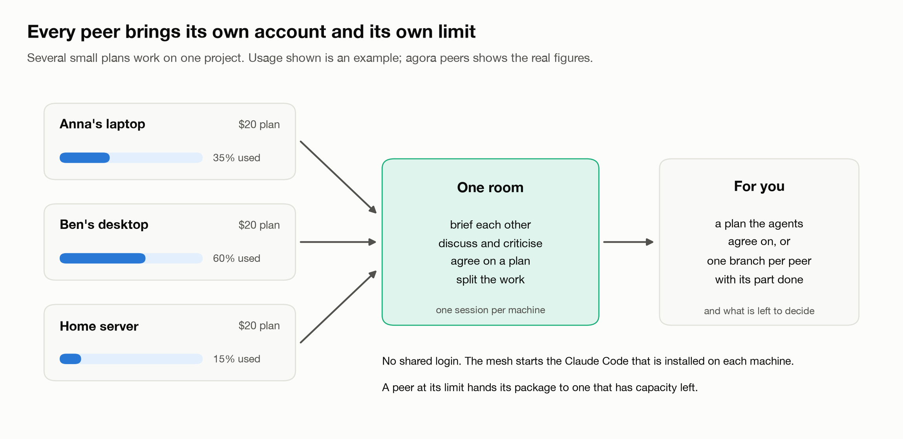

# agora-mesh

A peer-to-peer mesh for coding agents. It connects the agents on two or more machines so that they work on one large task together: they plan it, question each other's ideas, split it, and build their parts at the same time, each on its own machine and its own branch.

It was built for Claude Code and runs best there. A peer can also run Claude Code on another model, or another agent such as Codex or OpenCode.

No machine is the master. Every machine keeps its own login. It needs no VPN and no cloud account, and it does not use MCP.


*A room that ran on 2026-11-20, as it happened: nine messages, 422 seconds, one pushed branch per peer. [The run](docs/measurements/2026-11-real-agents.md).*

> **Status: early development, version 0.3.0.** It installs as a Claude Code plugin with prebuilt binaries for macOS, Linux and Windows. The next section says what was run and what was not; [ARCHITECTURE.md](ARCHITECTURE.md) describes how it is built.

*agora-mesh is an independent community project. It is not affiliated with or endorsed by Anthropic.*

## What it can do, and what it cannot

| It can | It cannot, or not yet |
|---|---|
| connect machines directly and encrypted, after a human approved each one | be safe with a peer you do not trust: a connected peer can make your machine run commands |
| let agents brief each other, discuss under a budget, and agree or ask you | make a small task cheaper: there one agent alone is faster and uses fewer tokens |
| split work and do the parts at the same time, one branch per peer | review or merge the branches for you; the measured results needed a review |
| hand a package to another peer when one reaches its usage limit | resume a room after the opener's daemon restarted |
| wait for your go before anyone starts working, on the machine that opened the room and on the one a package lands on | give the taker of a package more than its branch: no note on what was done and what is half-finished |
| ask one peer a question, hand it a task, have it review your changes | filter what you send to a peer: the block list guards the shared memory only |
| keep one memory on all machines, also as notes in an Obsidian vault | start at boot: the daemon starts on demand and with the plugin |
| run a peer on another model or on another agent | make every agent lean: an agent brings 11,000 to 18,000 tokens per turn of its own |

**Never run so far:** peers on different accounts; Windows; a NAT between two networks; a real usage limit (it was simulated); the model providers' own addresses that the presets point at (everything on other models went through a reseller); agents other than OpenCode, Qwen Code and Codex; a task on other models larger than two small files.

The full list of what is missing is in [ARCHITECTURE.md](ARCHITECTURE.md#12-not-built).

## What it is for

- **Planning something large with several instances of your best model.** `agora discuss "<topic>" --model fable` starts one session per machine on that model. They brief each other, propose, criticise and revise until they agree on a plan, or tell you what you have to decide.
- **Large tasks, split and done in parallel.** Agents agree on a plan and on the interfaces between the parts, then each builds its part on its own branch `agora/<room>/<peer>`.
- **Agents that check each other.** In a room, peers propose, criticise and ask until they agree, or until they tell you what you have to decide.
- **Knowledge that sits on different machines.** Each peer has its own files, its own `CLAUDE.md` and memory, and its own access. A question goes to the machine that can answer it.
- **A second opinion from another model.** A peer on a cheap model or on another agent takes part in the same room and the same format.
- **Every machine on its own login.** A room needs no shared account, and the mesh never sees a login or a key. When a peer reaches its usage limit, another takes over its package. [What that means for accounts and plans](#accounts-plans-and-terms).
- **A shared memory.** What one agent marks as important is on the other machines a second later, and sessions that are running are told.

## Models and agents that ran

| Runs in | Model | A session | A room | A work phase |
|---|---|---|---|---|
| Claude Code | Claude Sonnet, Claude Fable | yes | yes | yes |
| Claude Code, pointed at another model | deepseek-v4.1-flash | yes | yes | yes |
| | glm-5.3-flash | yes | yes | yes |
| | qwen3.8-flash | yes | yes, without tools | no |
| | minimax-m3.1-flash | yes | yes, without tools | no |
| OpenCode 1.19.6 | deepseek-v4.1-flash, glm-5.3-flash | yes | yes, with Claude Code | yes, with Claude Code |
| Qwen Code 0.28.0 | qwen3.8-flash | yes | no | no |
| Codex, through its adapter 2.8.0 | gpt-6-luna | yes | yes, with Claude Code | yes, with Claude Code |

"Yes" means it ran on a real machine and ended with a usable result. The Claude rows ran between a Mac and a Linux machine; the others between two daemons on one Mac, with the models reached through a reseller. How to set a peer up for another model or agent is under [other agents and other models](#other-agents-and-other-models).

## Measured

**Two agents build a stage of this project.** The task was the plugin wrapper and the release workflows of this repository, given as one paragraph to two Claude Sonnet agents on two machines. [Details and method](docs/measurements/2026-11-split-work.md).

| Seconds | |
|---|---|
| 0 to 49 | briefing, discussion, agreement on the interface between the parts, the split |
| 49 to 100 | both work at the same time, each in its own clone on its own branch |
| 108 | summary; two pushed branches, 11 files, no overlap, merged without a conflict |

The room used 889,880 tokens. One agent given the same task alone took 1,163 s and 1,859,692 tokens, but that is not a like-for-like speed-up: it ran far more checks on its own work, and the room's result needed four corrections in review. A room is fast at planning and splitting; its result still needs a review.

**What that means for larger tasks.** The room spent 57 s on briefing, discussion and summary; everything else was work done at the same time. Carried forward as a model, a room is slower than one agent below about two minutes of work and approaches half or a third of the time above it, depending on how much of the work can be split.


This is a model, not a measurement: it assumes equal packages and leaves out the time to review and merge the branches, which the measured run needed.

**Planning with two instances of the strongest model.** Asked how a small team moves a web shop to another database server without downtime, two Claude Fable sessions went through a proposal, a critique and a revised proposal and reached consensus on an eight-step plan in 49 s, using 248,909 tokens. The critique added what the first proposal lacked: revoking write rights on the old server at cutover, so that a writer nobody thought of fails loudly instead of writing to the wrong database.

**A small task is cheaper alone.** For a design question, a room with three sessions took 104 s and 711,673 tokens where one agent took 34 s and 179,409 ([details](docs/measurements/2026-11-room-with-three-sessions.md)). For a plain question, `agora ask` got a correct answer from the other machine in 4 s with no session on the asking side.

**What a session costs before anyone says anything.** Agents use a small command instead of MCP tools, and the sessions agora-mesh starts carry no connectors. Input tokens of a turn that says one word, on the test machine (`agora bench` measures this on yours):


| Session | Tokens |
|---|---|
| default headless session (7 connectors, 188 tools) | 195,258 |
| session started by agora-mesh, with the built-in tools | 23,994 |
| the same without tools (`agora discuss --lean`) | 3,743 |

This compares headless sessions. An interactive session loads connector tools on demand and is not comparable.

**Other models and other agents.** The same turn on other harnesses ([Claude Code on other models](docs/measurements/2026-11-claude-code-on-another-service.md), [agents](docs/measurements/2026-11-real-agents.md)):


Rooms on these models reached the same kind of result on far fewer tokens, and took longer:

| Room | Messages | Tokens, all peers | Time |
|---|---|---|---|
| two Claude Fable sessions plan a migration | 8 | 248,909 | 49 s |
| DeepSeek and GLM plan a change to a tool, with tools | 8 | 78,379 | 457 s |
| Qwen and MiniMax agree on a checklist, without tools | 9 | 21,515 | 240 s |
| Claude Code and OpenCode write a reply to a bug report | 8 | 83,413 | 156 s |
| DeepSeek and GLM split two small files and build them | 9 | 84,554 | 619 s |
| Claude Code and OpenCode do the same | 9 | 88,874 | 422 s |
| Claude Code and Codex do the same | 9 | 278,760 | 190 s |

All of the runs on other models together cost less than one US dollar at the reseller; the Codex runs went on a ChatGPT login. They say that the room's format holds on these models and that the work ends on one branch per peer. They do not say that the plans are as good as Claude's; nobody compared them.

## Shared memory, with Obsidian


Every network has one memory that all its peers keep as plain Markdown files. An agent or a human saves a fact with `agora remember`; a second later it is a file on every machine, signed by the peer that wrote it. Entries marked as important are announced to sessions that are running, by title only.

`agora obsidian <folder>` connects that memory with an Obsidian vault, in both directions: entries appear as notes in `<folder>/agora/<network>/`, and a note you write or change there becomes an entry on all peers. `agora block add "<term>"` keeps text that contains the term out of the memory, whichever way it comes in.

The block list guards the shared memory and nothing else. What goes to a peer directly is not checked against it: the questions and tasks of `agora ask` and `agora delegate`, the diff that `agora review` sends along, and everything said in a room.

## How it works

```
        Machine A                                   Machine B
 ┌──────────────────────┐                   ┌──────────────────────┐
 │ your agent session   │                   │  (no session needed) │
 │   $ agora discuss …  │                   │                      │
 └──────────┬───────────┘                   └──────────────────────┘
            │ local socket
 ┌──────────▼───────────┐   encrypted QUIC  ┌──────────────────────┐
 │    agora daemon      │◄─────────────────►│    agora daemon      │
 │  identity · rooms ·  │  direct, or via   │  identity · rooms ·  │
 │  shared memory       │  relay fallback   │  shared memory       │
 └──────────┬───────────┘                   └──────────┬───────────┘
            │ stdin / stdout                           │ stdin / stdout
 ┌──────────▼───────────┐                   ┌──────────▼───────────┐
 │ room session         │   room messages   │ room session         │
 │ (a fresh agent)      │◄ ─ ─ ─ ─ ─ ─ ─ ─ ►│ (a fresh agent)      │
 └──────────────────────┘                   └──────────────────────┘
```

1. Each machine runs a small background daemon with its own key pair.
2. One machine opens a network; others join with the network ID. A human approves every join.
3. Any peer opens a room for a topic. Each invited daemon starts a fresh session in its own clone of the project, on the agent and model that machine is set up for.
4. The opener briefs the others; then all take equal turns under a budget until they agree, split the work, or ask a human. Whoever makes a proposal has agreed to it; the room is agreed when every other peer says so.
5. If they agreed on a split, each peer does its package on its own branch, at the same time. With `--approve` the room first shows you the split and waits for your go.
6. The result goes back to the session that asked, and into the shared memory.

## Security: read this first

**A connected peer can make your machine run commands.** Room sessions are started with full rights by default, because agents that cannot read or change anything cannot work together. This applies to the person on the other machine and to anything that person's agent has read, such as a prepared web page. In a test run a session looked into the user's `~/.ssh/config` on its own, to answer a question about a host.

Connect only machines and people you trust with a shell on your computer. Connections are permanent until you revoke the peer.

| | |
|---|---|
| `agora trust <name> --rights read` | this peer's sessions here may only read |
| `agora trust <name> --rights talk` | this peer's sessions here get no tools |
| `agora trust <name> --work ask` | a work package from a room this peer opened waits for your `agora go` before it is built here |
| `agora discuss … --approve` | a room you open waits for your go once the peers agreed on a split |
| `agora revoke <name>` | remove a peer |
| `agora panic` | stop every room and its session on this machine |

**A go before the work.** By default a room that agreed on a split starts working at once, and a package that lands on your machine is built on arrival. Two switches put a human in between: `agora discuss --approve` on the machine that opens a room, and `agora trust <name> --work ask` on a machine that receives packages from that peer. Until the go nothing is changed anywhere.

Claude Code on Anthropic's service checks what a session does in its `auto` permission mode. Nothing does that on another model or in another agent, so such a peer only reads while a room discusses and gets its tools when the work phase starts. See [other agents and other models](#other-agents-and-other-models) before you let one work.

## Install

Tell your Claude Code

> Install https://github.com/kn0sti/agora-mesh and help me set it up.

or install the plugin yourself in a terminal:

```
claude plugin install agora-mesh --marketplace kn0sti/agora-mesh
```

[INSTALL.md](INSTALL.md) has the steps. The first call of `agora` downloads the binary for your platform from the GitHub release and checks it against `SHA256SUMS`. Or build from source with a stable Rust toolchain:

```
cargo build --release          # binary: target/release/agora
```

Connect two machines:

```
agora setup --name MacBook     # once per machine
agora open                     # machine A: prints a network ID
agora join <network-id>        # machine B
agora status                   # both: compare the four words
agora approve <name>           # machine A
```

## Use

Use the smallest command that does the job. The first four start no session on your machine; only the peer spends tokens.

| Command | |
|---|---|
| `agora peers` | who is reachable, what they are working on, which agent and model they run on, how much of their usage limit is used |
| `agora ask "<question>" --with <peer>` | one question to one peer |
| `agora delegate "<task>" --with <peer>` | hand a task to a peer; it reports done or blocked |
| `agora review --with <peer>` | a peer reviews your changes; the diff travels with the request, nothing has to be pushed |
| `agora discuss "<topic>"` | a room: the peers discuss, and split and do the work if they agree on a split |

Inside a git repository these commands are about that project, and every peer works in its own clone (`agora project add` registers one).

While a room runs:

| Command | |
|---|---|
| `agora rooms`, `agora watch <room>` | list rooms and invitations; follow one live |
| `agora accept <room>` | take an invitation, unless `agora trust <name> --level 2` lets that peer's invitations through |
| `agora say <room> "<text>"` | say something as a human, or answer when the agents ask you |
| `agora wait <room>` | the result of a room that paused for your answer |
| `agora invite <room> <peer>` | bring another peer into the running room |
| `agora discuss … --model fable` | the model every Claude session of the room uses; default is each machine's own |
| `agora discuss … --turns N --tokens N --lean` | turns per peer; token budget; discuss without tools |
| `agora discuss … --approve` | wait for your go once the peers agreed on a split, before anyone starts working |
| `agora go <room>` | start the work as agreed; on a machine a package waits on: build it |
| `agora say <room> "<what to change>"` | instead of the go: send the split back to the peers |
| `agora cancel <room>` | close the room without the work; on a machine a package waits on: refuse it |
| `agora discuss … --work-minutes N --work-tokens N` | minutes one package may take (60); tokens of the work phase after which no further package starts |

The shared memory and what happened:

| Command | |
|---|---|
| `agora remember "<text>" --title "<title>" --importance high` | save a fact on all peers |
| `agora memory`, `agora memory show <id>`, `agora forget <id>` | list, read, remove |
| `agora block add "<term>"` | never let this text into the shared memory from this machine; it does not filter questions, tasks, diffs or what is said in a room |
| `agora obsidian <folder>` | connect the memory with an Obsidian vault, in both directions |
| `agora events`, `agora notify '<command>'` | what happened; run a command for every event, for example to message your phone |
| `agora stats`, `agora bench` | what the rooms cost; what a session costs on this machine |
| `agora harness` | which agent and which model this machine's sessions run on, see below |

## Other agents and other models

A peer does not have to run Claude Code on a Claude model. Each machine chooses a **harness profile** for its own sessions; a room does not care which one a peer is on.

| | Example | What runs |
|---|---|---|
| Claude Code on another model service | `agora harness add deepseek --key file:~/.keys/deepseek` | Claude Code, pointed at the service's Anthropic-compatible address. Presets: `deepseek`, `glm`, `kimi`, `minimax`, `qwen`, `openrouter`, `ollama`, `lmstudio`, and `anthropic-compatible` for any other. |
| Another coding agent | `agora harness add opencode` | An agent that speaks the [Agent Client Protocol](https://agentclientprotocol.com). Presets: `opencode`, `gemini`, `qwen-code`, `kimi-code`, `goose`, `cline`, `copilot`, `cursor`, `minimax-code`, `kiro`, `vibe`, `codex-acp`, and `acp` for any other. |

```
agora harness presets            # what `add` knows
agora harness test deepseek      # two real turns: does it answer, keep to the room's format, report tokens?
agora harness default deepseek   # this machine's sessions now run on it
agora bench --harness deepseek   # what one turn costs there
agora peers                      # shows which harness each peer runs on
```

Of the two ways, Claude Code on another model is the lean one: it starts bare and reads a few hundred tokens per turn, where an agent brings its own system prompt and tools.


Read this before you rely on it:

- **Presets are from documentation.** The addresses and commands in the presets are what each vendor's documentation said on 2026-11-20. What ran for real is in [the table above](#models-and-agents-that-ran); everything on other models went through a reseller, not through the providers' own addresses. `agora harness test` is there so that you find out on your machine.
- **Keys.** A profile names where a key comes from (`env:NAME`, `file:PATH` or `cmd:COMMAND`, for example a keychain), never the key. A key for Anthropic in the environment is not passed on to another service.
- **What a session on another service sends.** Claude Code is started bare there: without `CLAUDE.md` files, memory, hooks and plugins, and never in the `auto` permission mode. Started the usual way it sent a `CLAUDE.md` from above the project, the path of the home directory, the user's permission rules and the state of the repository with every request. What still goes out besides the conversation is an identifier of the installation. The price: such a session reads no `CLAUDE.md` at all, also not the project's, and has the tools `Bash`, `Edit` and `Read` only.
- **Working needs a decision.** A session on another service can discuss, read, run read-only commands and use the shared memory. It cannot change files, so it cannot finish a work package. `--permission-mode bypassPermissions` on `agora harness add` lets it work, and then every command that model writes runs unchecked.
- **Why such a peer only reads while a room discusses.** Given tools and no check, two models did their packages during the discussion and pushed to `main`, also after the rules of the room told them not to. So every harness except Claude Code on Anthropic's service discusses with reading rights and does its package in a second session that starts with the work phase. After that change the same models ended with one branch per peer and `main` untouched.
- **Rights of an agent.** The rights of a room (everything, reading only, nothing) reach an agent in two ways: its requests for permission are answered from them, and for OpenCode, Qwen Code and Codex the preset puts the agent into its own read-only mode. OpenCode used its tools without asking in a real run, and Codex tried to start its package during the discussion and was stopped by its read-only mode. For an agent without such a preset the rights are only as strict as the agent asks.
- **Tokens.** An agent that does not report its tokens is counted by its context size or by text length, and `agora stats` says so. No harness but Claude Code on Anthropic's service reports how full a usage limit is.
- **Where your prompts go.** A profile on an outside service is marked external, and everything its sessions read is sent there. A file `.agora/no-external` in a project keeps such sessions out of it on that machine. What is said in a room reaches the service of every peer in it; `agora peers` shows who is external.
- **Errors that look like answers.** A reseller answered one model's requests with a sentence saying that the key may not use that model, sent as an ordinary answer. Nothing can tell such a sentence from a contribution; it went into the room until the other model asked for a human.
- **Terms of the providers.** Flat-rate coding plans of most providers exclude automated use; keys billed by usage do not. Anthropic documents pointing Claude Code at another address and says it does not support other models there.

The plan behind this, with what each agent and provider offers: [docs/design/other-harnesses.md](docs/design/other-harnesses.md).

## Accounts, plans and terms



Peers do not share a login. Each machine uses the login its agent already has, and the mesh never sees a login or a key: it only starts the program that is installed there.

- **Separate context windows.** Every session has its own, so a large task does not have to fit into one.
- **A peer at its limit hands over.** `agora peers` shows how much of its usage limit each Claude peer has used; when one reaches it in the middle of the work, its package moves to a peer that has capacity left.
- **Machines on the same account share one limit.** Two machines on one Claude account are two sessions on one allowance.
- **It does not make usage cheaper.** Agents that discuss use more tokens in total than one agent alone.

**Is this within the terms of your Claude plan?** That is yours to check; this is how the published terms read on 2026-11-20, not legal advice.

- agora-mesh runs the unmodified Claude Code, and every user signs in themselves through Anthropic's own login. It collects, stores and forwards no credentials. Anthropic's [legal page for Claude Code](https://code.claude.com/docs/en/legal-and-compliance) says its rules do not prevent "an end user from signing in to the unmodified Claude Code binary with their own Claude subscription".
- **Your own machines on your own account:** nothing in the pages read speaks against it.
- **Several people in one room, each on their own account:** a grey area. The [consumer terms](https://www.anthropic.com/legal/consumer-terms) say you may not "make your Account available to anyone else", and the legal page says that the limits of the plans "assume ordinary, individual usage". A request from another person's peer makes your account do work. The same page says Anthropic may enforce its rules without notice.
- **Getting around a limit by adding accounts** is not what this is built for.
- **Outside that question:** a peer that uses an API key, or another model, is not a consumer plan at all.

Peers on different accounts have not been run; every run so far had both machines on one account.

## Compared with

| | agora-mesh | Built-in cross-session messaging | MCP-based peer tools | Agent teams |
|---|---|---|---|---|
| Across machines | yes | yes, with Remote Control | varies | no |
| A login per machine | yes | no, same account | varies | no |
| Other agents and models as peers | yes | no | varies | no |
| Traffic path | direct, relay fallback | Anthropic servers | varies | local |
| Tool schemas in context | none | built-in | yes | built-in |
| Shared memory | yes | no | some | task list |
| Equal peers | yes | yes | varies | lead and teammates |

Development and tests: [CONTRIBUTING.md](CONTRIBUTING.md).

## License

[MIT](LICENSE)
