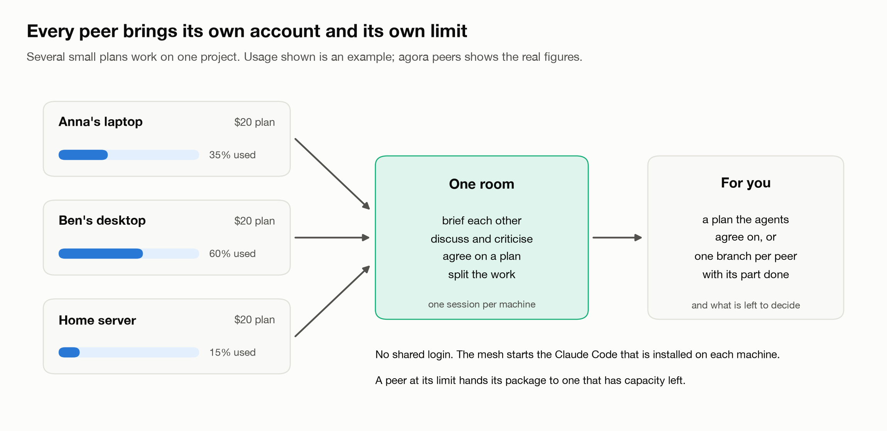

# Accounts, plans and terms

Peers do not share a login. Each machine uses the login its agent already has, and the mesh never sees a login or a key: it only starts the program that is installed there.

- **Separate context windows.** Every session has its own, so a large task does not have to fit into one.
- **A peer at its limit hands over.** `agora peers` shows how much of its usage limit each Claude peer has used; when one reaches it in the middle of the work, its package moves to a peer that has capacity left.
- **Machines on the same account share one limit.** Two machines on one Claude account are two sessions on one allowance.
- **It does not make usage cheaper.** Agents that discuss use more tokens in total than one agent alone.

**Is this within the terms of your Claude plan?** That is yours to check; this is how the published terms read on 2026-11-20, not legal advice.

- agora-mesh runs the unmodified Claude Code, and every user signs in themselves through Anthropic's own login. It collects, stores and forwards no credentials. Anthropic's [legal page for Claude Code](https://code.claude.com/docs/en/legal-and-compliance) says its rules do not prevent "an end user from signing in to the unmodified Claude Code binary with their own Claude subscription".
- **Your own machines on your own account:** nothing in the pages read speaks against it.
- **Several people in one room, each on their own account:** a grey area. The [consumer terms](https://www.anthropic.com/legal/consumer-terms) say you may not "make your Account available to anyone else", and the legal page says that the limits of the plans "assume ordinary, individual usage". A request from another person's peer makes your account do work. The same page says Anthropic may enforce its rules without notice.
- **Getting around a limit by adding accounts** is not what this is built for.
- **Outside that question:** a peer that uses an API key, or another model, is not a consumer plan at all.

Peers on different accounts have not been run; every run so far had both machines on one account.

[Back to the README](../README.md)
