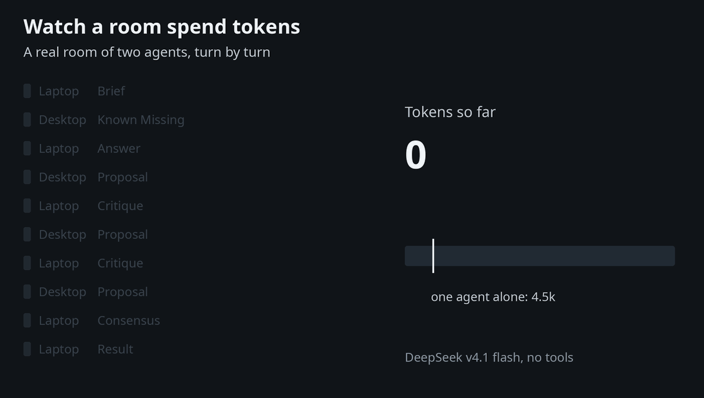
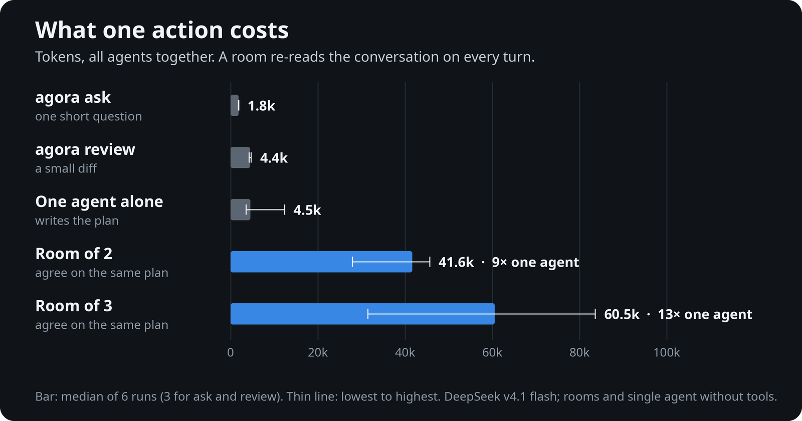
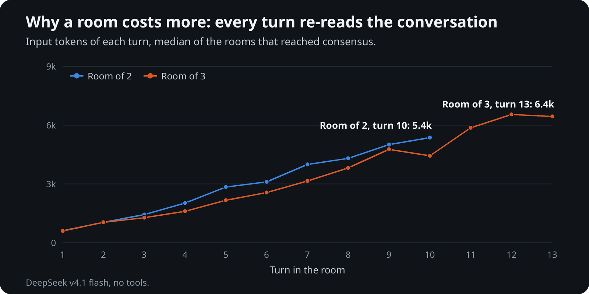

# What a room costs in tokens

Measured on 2026-11-21 with agora-mesh 0.6.0 and Claude Code 2.1.322, on `deepseek-v4.1-flash` through a reseller. The raw numbers of all 30 runs are in [data/2026-11-token-costs.json](data/2026-11-token-costs.json), and the figures are drawn from that file by `docs/img/make_cost_figures.py`. All runs together cost 1.09 US dollars.

## The short version

- **A room is not a way to save tokens.** On one small planning question, two agents used about 9 times as many tokens as one agent, and three agents about 13 times.
- **The cause is re-reading.** Every turn reads the conversation so far, so turns get more expensive as the room goes on.
- **Small commands stay small.** `agora ask` and `agora review` cost about as much as one short agent turn.

| Action | Runs | Tokens (median) | Lowest to highest | Time (median) | Compared with one agent |
|---|---|---|---|---|---|
| `agora ask`, one short question | 3 | 1,785 | 1,769 to 1,851 | 8 s | |
| `agora review`, a small diff | 3 | 4,434 | 4,243 to 4,710 | 10 s | |
| One agent alone writes the plan | 6 | 4,503 | 3,527 to 12,371 | 68 s | 1× |
| Room of 2, no tools (`--lean`) | 6 | 41,637 | 27,925 to 45,647 | 182 s | 9× |
| Room of 2, with reading tools | 6 | 50,506 | 17,688 to 65,964 | 192 s | 11× |
| Room of 3, no tools (`--lean`) | 6 | 60,544 | 31,447 to 83,596 | 272 s | 13× |

## Why it grows

The first turn of a room reads about 600 tokens. By the tenth it reads about 5,400, because everything that was said is part of its context. This is why a long discussion costs far more than its last message suggests, and why rooms have a turn budget and a token budget.

## How it was run

Each run used three fresh daemons on one Linux machine, each with its own data directory. Sessions were Claude Code, started bare by agora-mesh, with no way to change files.

- **The question** was the same in every run: plan how a small team moves a web shop to a new PostgreSQL server without downtime, with steps, risks and a rollback, and agree on one written plan.
- **One agent alone** answered it in a single `claude -p` call, bare and without tools.
- **`agora ask` and `agora review`** ran as one turn of a bare session that had its tools available but no permission to change anything.
- **Rooms** used `agora discuss --turns 3`. Tokens are the sum over all sessions, input and output, with cached input counted as input.
- **How the rooms ended.** Rooms of two without tools: 6 of 6 reached consensus. Rooms of three: 5 of 6, one ran out of turns. Rooms of two with reading tools: 2 of 6 reached consensus, 3 ran out of turns and 1 stopped to ask a human.

## What this does not show

- **Quality.** The room's plan went through a critique and the single agent's did not. Nobody compared the plans, so the factor says what a room costs, not whether it is worth it.
- **Large tasks.** This is one small question, where the discussion is nearly the whole cost. In a larger task the discussion is a fixed part and the building dominates. See the [split-work run](2026-11-split-work.md).
- **Other models and agents.** A bare session on this model starts with a few hundred tokens. Claude Code with its built-in tools starts at about 24,000 tokens per turn on the test machine, so the same room on Claude costs much more in absolute terms (`agora bench` measures it on your machine).
- **Tools.** Six runs are too few to say that reading tools cause a room to agree less often.

## Keeping a room cheap

1. Use `agora ask` or `agora review` when one answer is enough.
2. Use `--lean` when the discussion needs no access to files.
3. Keep rooms small. Each added agent also re-reads everything.
4. Set limits: `--turns` per agent and `--tokens` for the whole room.

[All measurements](README.md) · [Back to the README](../../README.md)
