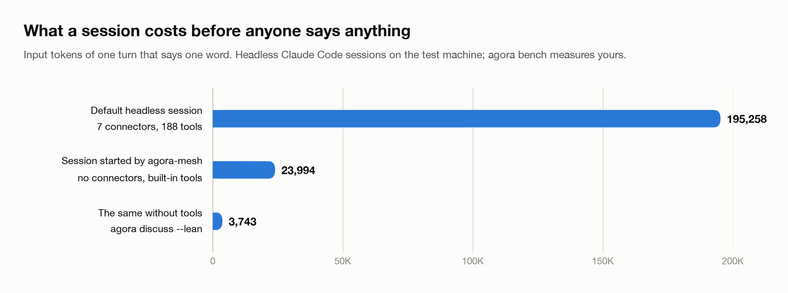

# What was measured

**Two agents build a stage of this project.** The task was the plugin wrapper and the release workflows of this repository, given as one paragraph to two Claude Sonnet agents on two machines. [Details and method](2026-11-split-work.md).

| Seconds | |
|---|---|
| 0 to 49 | briefing, discussion, agreement on the interface between the parts, the split |
| 49 to 100 | both work at the same time, each in its own clone on its own branch |
| 108 | summary; two pushed branches, 11 files, no overlap, merged without a conflict |

The room used 889,880 tokens. One agent given the same task alone took 1,163 s and 1,859,692 tokens, but that is not a like-for-like speed-up: it ran far more checks on its own work, and the room's result needed four corrections in review. A room is fast at planning and splitting; its result still needs a review.

**What that means for larger tasks.** The room spent 57 s on briefing, discussion and summary; everything else was work done at the same time. Carried forward as a model, a room is slower than one agent below about two minutes of work and approaches half or a third of the time above it, depending on how much of the work can be split.

This is a model, not a measurement: it assumes equal packages and leaves out the time to review and merge the branches, which the measured run needed.

**Planning with two instances of the strongest model.** Asked how a small team moves a web shop to another database server without downtime, two Claude Fable sessions went through a proposal, a critique and a revised proposal and reached consensus on an eight-step plan in 49 s, using 248,909 tokens. The critique added what the first proposal lacked: revoking write rights on the old server at cutover, so that a writer nobody thought of fails loudly instead of writing to the wrong database.

**A small task is cheaper alone.** For a design question, a room with three sessions took 104 s and 711,673 tokens where one agent took 34 s and 179,409 ([details](2026-11-room-with-three-sessions.md)). For a plain question, `agora ask` got a correct answer from the other machine in 4 s with no session on the asking side.

**What a session costs before anyone says anything.** Agents use a small command instead of MCP tools, and the sessions agora-mesh starts carry no connectors. Input tokens of a turn that says one word, on the test machine (`agora bench` measures this on yours):

| Session | Tokens |
|---|---|
| default headless session (7 connectors, 188 tools) | 195,258 |
| session started by agora-mesh, with the built-in tools | 23,994 |
| the same without tools (`agora discuss --lean`) | 3,743 |

This compares headless sessions. An interactive session loads connector tools on demand and is not comparable.

**Other models and other agents.** The same turn on other harnesses ([Claude Code on other models](2026-11-claude-code-on-another-service.md), [agents](2026-11-real-agents.md)):

Rooms on these models reached the same kind of result on far fewer tokens, and took longer:

| Room | Messages | Tokens, all peers | Time |
|---|---|---|---|
| two Claude Fable sessions plan a migration | 8 | 248,909 | 49 s |
| DeepSeek and GLM plan a change to a tool, with tools | 8 | 78,379 | 457 s |
| Qwen and MiniMax agree on a checklist, without tools | 9 | 21,515 | 240 s |
| Claude Code and OpenCode write a reply to a bug report | 8 | 83,413 | 156 s |
| DeepSeek and GLM split two small files and build them | 9 | 84,554 | 619 s |
| Claude Code and OpenCode do the same | 9 | 88,874 | 422 s |
| Claude Code and Codex do the same | 9 | 278,760 | 190 s |

All of the runs on other models together cost less than one US dollar at the reseller; the Codex runs went on a ChatGPT login. They say that the room's format holds on these models and that the work ends on one branch per peer. They do not say that the plans are as good as Claude's; nobody compared them.

[Back to the README](../../README.md)
